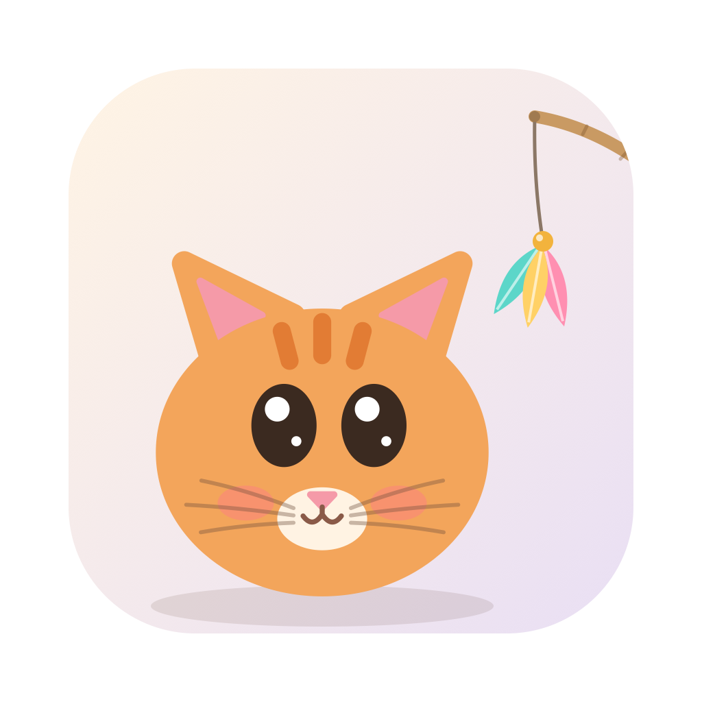

# 逗猫 CatToy 🐾

一只住在 macOS 桌面上的小猫。你的鼠标就是逗猫棒：晃一晃，它会盯着看、压低身子扭屁股、扑上来拍羽毛；不理它，它就自己舔毛、睡觉。

- 小猫走在 Dock 上沿，不挡你干活；点击会穿透到下面的窗口
- 三个品种：橘猫、奶牛猫、三花
- 原生小程序，压缩包不到 100 KB，几乎不占 CPU

## 下载安装

1. 到 [Releases](../../releases/latest) 下载 `CatToy.zip`，解压得到 `CatToy.app`
2. 把 `CatToy.app` 拖进「应用程序」文件夹
3. 双击打开。第一次打开时 macOS 会提示“无法验证开发者”（这个小程序没有付费做 Apple 公证），按下面任意一种方式放行，之后就能正常双击打开了：
   - **系统设置 → 隐私与安全性**，在页面下方找到 CatToy，点「仍要打开」
   - 或者在终端运行：
     ```bash
     xattr -dr com.apple.quarantine /Applications/CatToy.app
     ```

支持 macOS 12 及以上，Intel 和 Apple 芯片都可以。

## 怎么玩

- **逗猫**：移动鼠标，鼠标握着的是逗猫棒的把手
- **打开菜单**：点一下小猫，可以收起/拿出逗猫棒、换品种、退出
- 菜单栏也有一个爪印图标，菜单相同（菜单栏图标太多时它可能被刘海挡住）
- 想开机自动出现：系统设置 → 通用 → 登录项，加入 CatToy

## 浏览器里试玩

不想装的话，直接用浏览器打开 `cat.html` 就能玩，右上角可以换品种。

## 从源码打包

需要 Xcode 命令行工具（`xcode-select --install`）：

```bash
./desktop/build.sh
```

生成 `desktop/build/CatToy.app` 和可分发的 `desktop/build/CatToy.zip`。

- `cat.html`：猫和逗猫棒的全部绘制、物理和行为（浏览器、桌面共用）
- `desktop/main.swift`：macOS 外壳，透明点击穿透窗口、全局鼠标、菜单
- `desktop/icon.svg`：应用图标源文件，改完运行 `./desktop/make_icon.sh` 重新生成 `AppIcon.icns`
